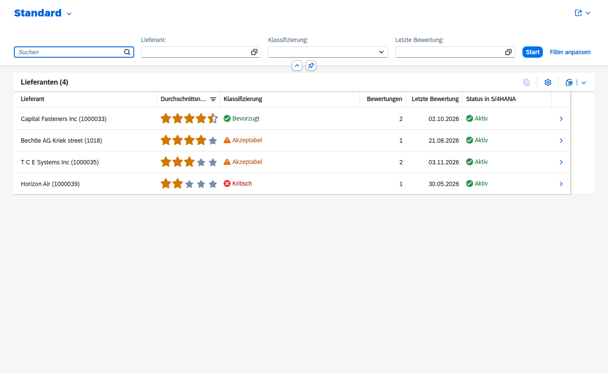
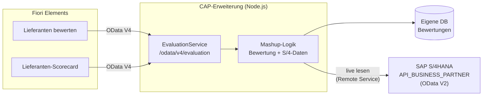
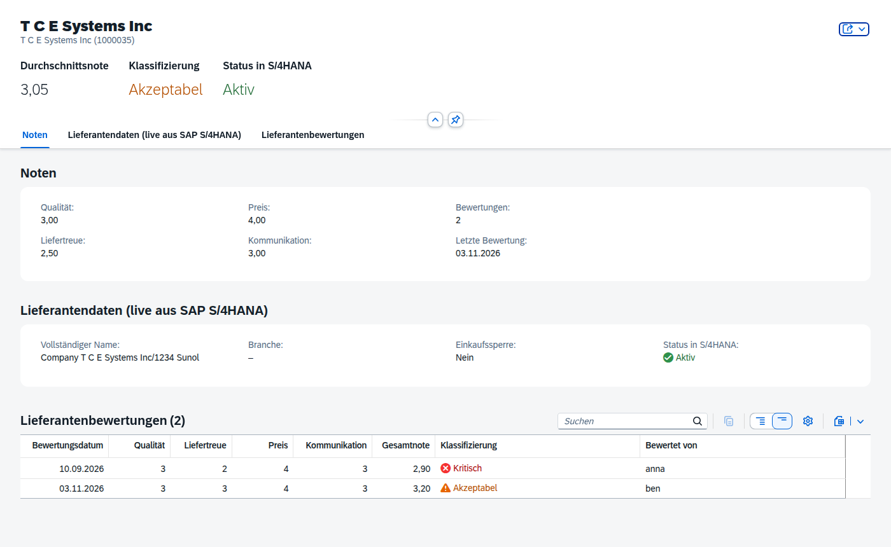
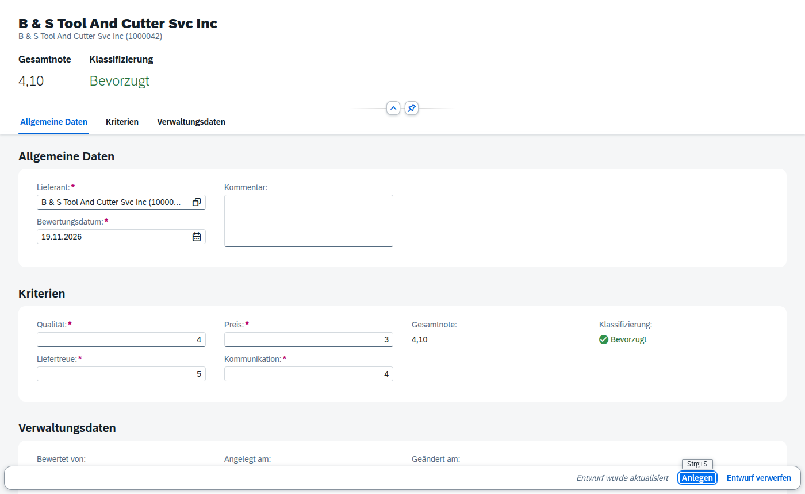
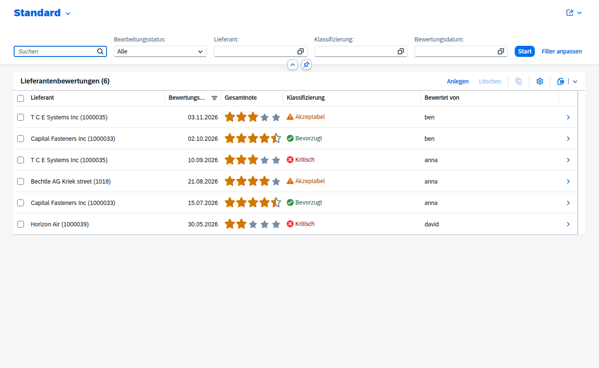
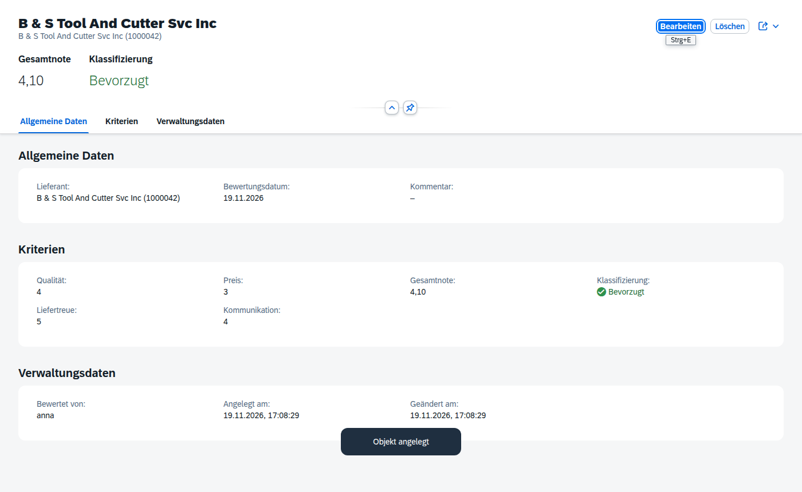

# Lieferantenbewertung – Side-by-Side-Erweiterung zu SAP S/4HANA

**SAP CAP (Node.js) · Remote Service `API_BUSINESS_PARTNER` · Fiori Elements · OData V4 · Clean Core**

[](https://github.com/macleodc708/sap-cap-supplier-evaluation/actions/workflows/ci.yml)

Einkäufer bewerten Lieferanten nach **Qualität, Liefertreue, Preis und Kommunikation**. Daraus entstehen eine gewichtete
Gesamtnote und eine **ABC-Klassifizierung**. Die **Lieferanten selbst kommen live aus SAP S/4HANA** über die
Standard-Schnittstelle `API_BUSINESS_PARTNER`. Gespeichert werden in der Erweiterung **nur die eigenen Daten**, also die Bewertungen.

Genau so empfiehlt SAP heute Erweiterungen: **„Clean Core“**. Das ERP-System bleibt unverändert, und die Erweiterung läuft
daneben (*Side-by-Side*, z. B. auf der SAP BTP) und spricht nur über freigegebene APIs mit S/4HANA.

> *English summary:* A side-by-side extension for SAP S/4HANA built with SAP CAP. Supplier master data is consumed live
> from the S/4HANA Business Partner API (tested against the SAP Business Accelerator Hub sandbox with 1,700+ real demo suppliers)
> and mashed up with locally stored supplier evaluations. It features a remote OData V2 service, mocking for local
> development and tests, live enrichment of aggregated KPIs, graceful degradation when S/4HANA is unavailable,
> draft handling, instance-based authorization, i18n (DE/EN) and CI.



---

## Was das Projekt zeigt

| Thema | Umsetzung |
|---|---|
| **S/4HANA-Anbindung** | `API_BUSINESS_PARTNER` (OData V2) als **Remote Service**, importiert mit `cds import`, verwendet wird die Entität `A_Supplier` |
| **Mashup** | Lokale Bewertungen und Live-Daten aus S/4HANA werden **im Service zusammengeführt**, z. B. `$expand=supplier` und Live-Status in der Scorecard. |
| **Lokal entwickeln, live betreiben** | Ohne Zugangsdaten bildet CAP S/4HANA **automatisch mit Testdaten nach**. Mit dem Profil `sandbox` spricht dieselbe App mit dem **echten SAP-System**. |
| **Robustheit** | Ist S/4HANA nicht erreichbar, liefert die Scorecard trotzdem die lokalen Kennzahlen, mit einem Hinweis statt eines Fehlers. |
| **Prüfungen gegen S/4HANA** | Beim Speichern wird geprüft, ob der Lieferant in S/4HANA existiert. Bei Einkaufssperre erscheint eine Warnung. |
| **Wertehilfe aus S/4HANA** | Die Lieferantenauswahl sucht live in S/4HANA. `$search` wird dafür in einen OData-V2-Filter übersetzt, weil V2 kein `$search` kennt. |
| **Bewertungslogik** | gewichtete Note (35 % Qualität, 30 % Liefertreue, 20 % Preis, 15 % Kommunikation, konfigurierbar), ABC-Klassifizierung, Live-Berechnung im Entwurf |
| **Berechtigungen** | Einkäufer sehen alle Bewertungen, ändern aber **nur ihre eigenen**. Die Einkaufsleitung darf alles. |
| **Tests & CI** | 15 automatisierte Tests gegen den S/4HANA-Mock, Lint und Tests laufen bei jedem Push. |

## Architektur



| Daten | Wo gespeichert? |
|---|---|
| Lieferanten (Name, Einkaufssperre, …) | **nur in S/4HANA**, wird bei Bedarf live gelesen |
| Bewertungen, Noten, Kommentare | in der **Datenbank der Erweiterung** |
| Lieferantenname in der Bewertung | als **Kopie zum Bewertungszeitpunkt**, damit Listen auch ohne S/4-Aufruf schnell sind |

## Screenshots

Aufgenommen gegen die **SAP-API-Sandbox**, also mit echten Demo-Lieferanten aus S/4HANA Cloud.

| | |
|---|---|
| **Scorecard-Detail** mit Live-Daten aus S/4HANA | **Bewertung anlegen**: Note und Klassifizierung live |
|  |  |
| **Alle Bewertungen** | **Gespeicherte Bewertung** |
|  |  |

## Starten

Voraussetzung: **Node.js 22** oder neuer.

```bash
git clone https://github.com/macleodc708/sap-cap-supplier-evaluation.git
cd sap-cap-supplier-evaluation
npm install
```

### Variante A: mit nachgebildetem S/4HANA (ohne Zugangsdaten)

```bash
npm run watch
```

### Variante B: gegen die echte SAP-Sandbox

1. Kostenlos auf [api.sap.com](https://api.sap.com) anmelden und den **API-Key** kopieren (Profil → Settings → „Show API Key“).
2. Im Projektordner eine Datei `.sandbox.env` anlegen (sie ist per `.gitignore` von Git ausgeschlossen):
   ```
   cds.requires.API_BUSINESS_PARTNER.credentials.headers.APIKey=<dein-api-key>
   ```
3. Starten:
   ```bash
   npm run watch:sandbox
   ```

Dann **http://localhost:4004/launchpad.html** öffnen.

### Demo-Benutzer (Passwort jeweils `demo`)

| Benutzer | Rollen | Darf |
|---|---|---|
| `anna`, `ben` | Purchaser | bewerten, alle Bewertungen sehen, eigene ändern |
| `david` | Purchaser, PurchasingManager | alle Bewertungen ändern und löschen |

## Tests

```bash
npm test      # 15 Tests gegen den S/4HANA-Mock (keine Zugangsdaten nötig)
npm run lint
```

## Projektstruktur

```
db/schema.cds                     Datenmodell: Bewertungen, Klassifizierung, Auswertung je Lieferant,
                                  Projektion auf den S/4HANA-Lieferanten (A_Supplier)
srv/external/API_BUSINESS_PARTNER S/4HANA-Schnittstellenbeschreibung (EDMX) und importiertes CDS-Modell
srv/external/data/                Testdaten für den S/4HANA-Mock (echte IDs aus der SAP-Sandbox)
srv/evaluation-service.*          Service und Mashup-Logik
srv/lib/scoring.js                Notenberechnung und ABC-Klassifizierung
app/evaluations/                  Fiori-App „Lieferanten bewerten“
app/scorecard/                    Fiori-App „Lieferanten-Scorecard“
```

## Bewusste Vereinfachungen und nächste Schritte

- **Produktive Anbindung** über eine **BTP-Destination** (z. B. mit Principal Propagation) statt API-Key, Konfiguration nur in `package.json`
- **Ereignisgesteuert**: auf S/4HANA-Events wie „Lieferant geändert“ reagieren statt nur bei Bedarf zu lesen
- **Caching** der Lieferantendaten für große Listen
- **Verknüpfung mit Bestellungen** (`API_PURCHASEORDER_PROCESS_SRV`), um die Liefertreue automatisch aus Wareneingängen zu berechnen

Verwandtes Projekt: [Bestellanforderung mit Freigabeprozess](https://github.com/macleodc708/sap-cap-purchase-requisition)

## Hinweise

- Die Schnittstellenbeschreibung `API_BUSINESS_PARTNER.edmx` stammt aus
  [SAP-samples/cloud-cap-risk-management](https://github.com/SAP-samples/cloud-cap-risk-management) (Apache-2.0).
- Entwickelt mit Unterstützung von KI (Claude von Anthropic).

## Lizenz

[MIT](LICENSE)
